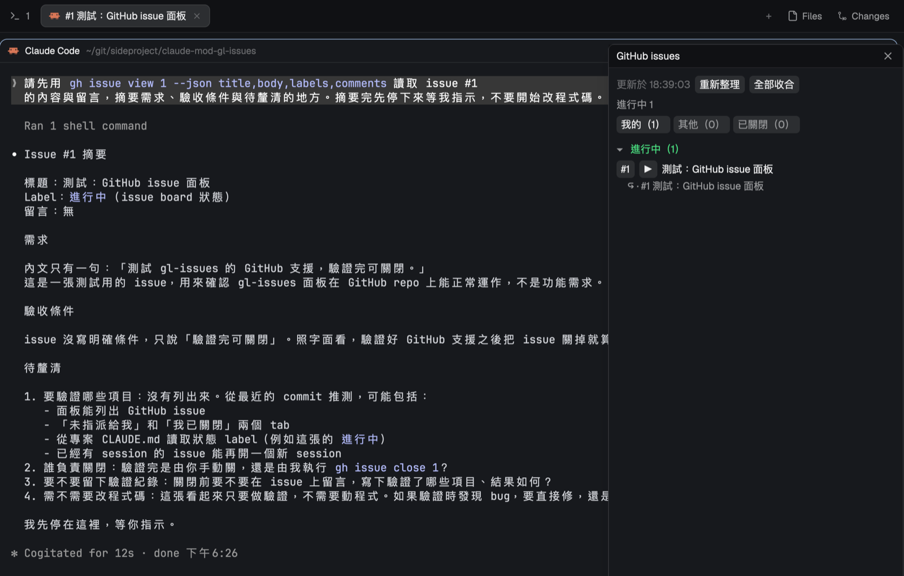

# Issue launcher

A floating window that lists the GitLab or GitHub issues of the repo you are working in, grouped by your board's status labels. Under each issue it shows the Herdr agents already working on it. One click jumps to an agent, starts a new Claude Code session that reads the issue, or opens the issue in the browser.

This file is the brief: enough to build Issue launcher from an empty folder. The files next to it (`mods/issue-launcher/`) are one build of it. If they don't work on your Herdr, or you want it different, build it again from here. The panel text is Traditional Chinese, as in the build; translate the strings if you want another language.

## What you see

A Herdr window (`kind: "window"`), 380px wide and 80% of the window's height. It sits over the layout, can be dragged anywhere, and reopens where it was left on the next start. It adds nothing to your layout.

1. **Title row**, 30px, theme `chrome` background, 1px `border` line underneath: "GitHub issues" or "GitLab issues" (semibold), or "Issues" before a repo is known. A ✕ on the right closes the window.
2. **Header**, then a scrolling body. 10px padding, 10px gaps, 13px text on theme `surface`:
   - "更新於 HH:MM:SS" (the last fetch time) in `dim`, then a 重新整理 button and a 全部收合 / 全部展開 button.
   - A summary of the open issues assigned to you per status, without the done status, in `muted`: "進行中 2 · 討論中 5".
   - Three tab buttons with counts: 我的（n）, 其他（n）, 已關閉（n）. The selected one uses `selected`, the others `raised` with `muted` text. "…" stands in for a count that isn't loaded yet.
   - Messages: a red (`ansi1`) "gh 失敗：<reason>" line, "目前的 space 不在 git repo 裡。", or an empty-list line such as "沒有指派給你的 open issue。"
   - Status groups: a ▾ or ▸ arrow, then the status name and count, semibold, in the status color. The done status is drawn in `dim`.
   - Each issue row: a `#<id>` button, a ▶ button (shows "…" for 3s after a click), then the title, cut with an ellipsis.
   - Under an issue, one line per matched agent, indented 14px, in `muted`: "↪ ◑ #12 新增登入頁". The mark shows the agent's status and the text is its tab name, or its terminal title when the tab is unnamed.

Buttons are small chips: 6px horizontal padding, 5px corners, `raised` background, `hover` on hover. Every color except the status colors comes from `theme()`, so the window follows light and dark themes.

Status colors come from the board (see below). Default palette in order: `#4ade80`, `#facc15`, `#22d3ee`, `#c084fc`, `#60a5fa`, `#fb923c`, `#f472b6`.

## How it behaves

- **Which repo:** the active space's focused pane folder, else the focused terminal's folder, else the space folder, on the space's machine. `git rev-parse --show-toplevel` turns that into the repo root. Switching spaces switches repos.
- **Which CLI:** `gh` when `origin` contains `github.com:` or `github.com/`, otherwise `glab` (self-hosted GitLab, and repos with no origin).
- **Tabs:**
  - 我的: open issues assigned to you.
  - 其他: every open issue minus yours, unassigned ones included.
  - 已關閉: your closed issues.

  Each list holds at most 100 issues. A failing 其他 or 已關閉 fetch shows its error on that tab only.
- **Board:** the list under a `## Issue 狀態` heading in the repo's `CLAUDE.md`, else `.claude/CLAUDE.md`. Each item is one label, and an item can end with `#rgb` or `#rrggbb` to set its color. The last item is the done status. Without the section, the board is 進行中, 檢驗中, 測試站待檢驗, 正式站待檢驗, 已上線待檢驗, 可處理, 討論中, 已完成. The board is re-read on every fetch.
- **Grouping:** each issue goes in the first board label it carries, else （無狀態）, which comes last. Issues are sorted by number. 已關閉 is one group, newest first.
- **Collapse:** click an arrow to fold one group. At first only the done group is folded. 全部收合 and 全部展開 touch only the groups on screen. The folded set and the chosen tab survive a reload.
- **Refresh:** fetches on start, every 5 minutes, and on 重新整理. While a fetch runs, the button reads 讀取中… and further clicks are ignored. A 1-second timer notices when the focused folder or machine changes, re-checks the repo, and fetches again only when the repo changed. A failed 我的 fetch keeps the previous lists on screen.
- **Agent statuses:**

  | Status | Mark |
  | --- | --- |
  | working | ◑ |
  | blocked | ! |
  | done | ✓ |
  | idle | · |

  Lines update live, without refetching.
- **Matching:** an agent counts when its folder is the repo root, under it, or contains it, and it runs on the same machine. Its tab name, title, folder and launch arguments are searched for issue numbers (1–5 digits) after `#`, `gl-`, `/issues/`, `/work_items/`, or the words `issue`, `work item` or `票`. Agents that mention the issue more often are listed first.
- **Clicks:**
  - A matched agent line focuses that agent (`agent.focus`).
  - ▶ opens a new tab in the active space named `#<id> <title>`, cut to 40 characters. The tab runs `claude -n "<that name>"` in the repo root, with a first message asking Claude to read the issue and its comments, summarise the requirement, acceptance criteria and open questions, and stop. The issue is read with `gh issue view <id> --json title,body,labels,comments` or `glab issue view <id> --comments`. The new session shows up under the issue by itself.
  - `#<id>` opens the issue page with `open` (macOS) or `xdg-open`. A failure posts an error notification.
- **Nothing animates.** Timers only fetch data.

## Built from

- **One mod**, `mods/issue-launcher/`, with no layout and no `keys.json`:
  - `mod.json`: `{ "place": "none", "title": "Issues", "overlay": { "kind": "window", "key": "issue-launcher", "keep": true, "width": 380, "height": 0.8 } }`. Open it with `mod.open {name: "issue-launcher"}` (`herdr-app do mod.open --name issue-launcher`, or the command palette).
  - `logic.js`: pure functions with no `herdr` imports, so `node --test` can run them. Board parsing, provider detection, CLI arguments, JSON parsing for both CLIs, grouping, mention extraction, agent filtering, the post-fetch state, tab names and the first message.
  - `main.js`: the View. It holds the state, the timers, the `exec` calls and the rendering.
- **herdr data:** `spaces()`, `focused()`, `panes()` (folder per pane), `agents()`, `terminals()` (argv), `theme()`, `window()` (platform), `props().overlay`.
- **herdr calls:**
  - `exec` for `git`, `gh`, `glab`, `open` and `xdg-open`, with `on` set to the space's machine.
  - `readTextFile` for `CLAUDE.md`.
  - `run("tab.new", { name, space, folder, argv, task })`.
  - `run("agent.focus", { terminal })`.
  - `notify`, `closeOverlay`.
- **State:** the fetched lists live on the View instance. `localStorage` keys `tab` and `collapsed` hold the per-copy choices.
- **Programs it runs:** `git`, `gh` or `glab` (the network goes through them), `claude` in the new tab, and `open` or `xdg-open`. It reads only `CLAUDE.md` and `.claude/CLAUDE.md` inside the repo.

## Watch out

- **`place: "right"` did not dock the mod** into the shipped `main` layout on Herdr as of 2026-11-15. That held after a restart and after switching layouts, which is why it is a window. If docking works on your Herdr, a side block is fine too.
- **Don't symlink the mod folder or its files.** A symlinked folder never showed up in `seen.json`. With per-file symlinks, `import "./logic.js"` fails `herdr-app check` ("resolves outside the application directory") and saving the source doesn't reload. Copy the files instead. The source repo's `scripts/install.sh` does that and refuses to overwrite a folder it didn't install.
- **Esc doesn't close a window,** so the ✕ is required. Stop mouse-down on every control (`cx.stop_propagation()`), or pressing it drags the window.
- **Call `cx.notify()` when a fetch starts,** not only when it ends, or the 重新整理 button never shows 讀取中….
- **Don't refetch on every folder change.** Moving focus between panes in one repo would run three `gh`/`glab` list calls each time. Compare the repo root first.
- **`herdr-app shot` returns the last frame Herdr drew.** It is stale while Herdr isn't redrawing, so switch something on screen before shooting.
- **`glab` prints a lone `ERROR` line before the reason.** Skip it when showing the error.
- **`sameProject` also matches an agent whose folder contains the repo,** such as an agent started in `~`, as long as it mentions the issue number.
- **Issue numbers are only meaningful per repo,** so a stray "#1" in another agent of the same repo gives a false match.
- **Herdr's own worktrees live outside the repo** (`~/.herdr/worktrees/<repo>/<branch>`), so their agents are not matched.
- **Assumptions:** `gh` or `glab` are logged in, and `claude` is on the login shell's PATH. Status labels share the same names on GitHub and GitLab.

## Done when

- `herdr-app check ~/.config/herdr-app/mods/issue-launcher` prints `check passed`.
- `node --test test/` passes. The repo's tests cover every example table: origin URLs, CLI arguments, mention extraction, grouping, a failed fetch keeping the old list, and per-tab errors.
- In a GitHub repo space, the window lists the same issues as `gh issue list --assignee @me`, grouped as the board says. In a repo with no remote, it shows "glab 失敗：No git remotes found.", and in a folder outside git, "目前的 space 不在 git repo 裡。"
- Switching to a space in another repo switches the list. Moving focus within one repo doesn't change "更新於".
- Folding a group, then reinstalling the mod, keeps it folded. ✕ closes the window and `mod.open` reopens it.
- ▶ opens a tab named `#<id> <title>` in which Claude summarises the issue and stops. The tab then appears under the issue, and clicking that line focuses it.
- `#<id>` opens the issue in the browser.
